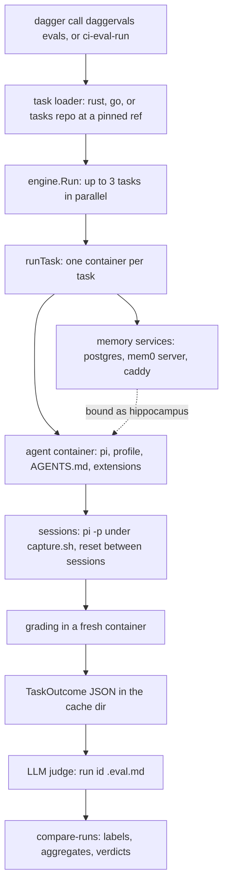
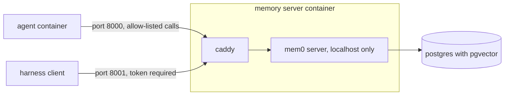

# Eval tasks and how the evals run

The evals run the agent setup of this repo (profile, `AGENTS.md`, extensions, memory) on fixed
tasks and grade the result by tests. They try to answer three questions:

- When does delegating to subagents pay off? The long and parallel tasks.
- Does memory recall help? The `memory-*` tasks, with memory on and off.
- Does the setup fix real bugs? The Rust and Go tasks taken from open source repos.

Only the outcome is graded, never whether the agent delegated or used memory. Everything lives in
the Dagger module `.dagger/modules/daggervals`. How a PR triggers evals in CI is in
[ci-eval.md](ci-eval.md).

The task fixtures of the long, parallel and memory tasks live in the public repo
[pepi-eval-tasks](https://github.com/Jacarte/pepi-eval-tasks). The Rust, Go and `hello` tasks live
in this repo.

## Read the numbers with care

The results below come from local runs, with 3 or 5 runs per arm and one task at a time. They are
one run set, not a benchmark. Each number carries its n. Tasks were edited between some runs, and
the tasks-repo commit is part of every run id. The judge model's own verdicts say the same: with
n=3 and overlapping ranges a difference is noise, and a cause is only named when the data shows it.

## Task index

| Task | Lives in | Kind | Sessions | Scoring | What it measures | Status |
|---|---|---|---|---|---|---|
| `hello` | this repo | smoke | 1 | pass/fail | The setup boots and the agent answers its probes | Runs on every push to `main` |
| `r1` to `r8` | this repo | bug fix (Rust) | 1 | pass/fail | Fixing a real upstream bug | In the `rust` shard; no results kept here |
| `g1` to `g5` | this repo | bug fix (Go) | 1 | pass/fail | Fixing a real upstream bug | In the `go` shard; no results kept here |
| `kv-database` | tasks repo | long | 3 | prefix, 6 milestones | Long-horizon work over several sessions | `tasks-long`; no results kept here |
| `five-modules` | tasks repo | parallel | 1 | count, 5 milestones | Independent work under a deadline | `tasks-long`; no results kept here |
| `legacy-monolith` | tasks repo | parallel | 1 | count, 13 milestones | A cross-cutting change in a large codebase | `tasks-long`; no results kept here |
| `twelve-modules` | tasks repo | parallel | 1 | count, 12 milestones | Independent work under a tighter deadline | `tasks-long`; n=3 per arm, 5 arms |
| `memory-key` | tasks repo | memory | 1 | count, 1 milestone | Using a fact that exists only in memory | on 3/3, off 0/3 (n=3) |
| `memory-oncall` | tasks repo | memory | 1 | count, 1 milestone | Picking the right facts out of many memories | on 3/3, off 0/3 (n=3) |
| `memory-recall` | tasks repo | memory | 1 | count, 1 milestone | Recalling a configuration value | No effect seen (n=3) |
| `memory-stale-doc` | tasks repo | memory | 1 | count, 3 milestones | Memory that corrects misleading docs | No effect seen (n=3) |
| `memory-convention` | tasks repo | memory | 1 | count, 4 milestones | Following project conventions kept in memory | Inconclusive (n=3) |
| `memory-slowtests` | tasks repo | memory | 1 | count, 1 milestone | Effort saved by remembered project practice | Same score; faster with memory (n=3) |
| `memory-carryover` | tasks repo | memory | 2 | count, 2 milestones | What session 2 recalls from session 1 | No clear change (n=5) |

Which shards run in CI: `rust` (r1 to r8), `go` (g1 to g5), `tasks-memory` (the six memory tasks
with a fixture), and `tasks-long` (five-modules, kv-database, legacy-monolith, memory-carryover,
twelve-modules; full tier only). The lists are in `internal/evals/ci/tiers.go`.

## Tasks in this repo

### hello

The agent is told to print a few lines about the tools, subagents, packages and extensions it
can see, and whether its context holds the global AGENTS.md rules, then to finish with the words
`hello world`. The oracle checks that the final output says `hello world`. It measures whether
the profile boots and the agent answers the probes, not coding ability. The
GitHub workflow `daggervals.yml` runs it on every push to `main`. It has no cache. Source:
`internal/evals/task/hello_world.go`.

### Rust tasks r1 to r8 and Go tasks g1 to g5

The agent gets the text of the upstream GitHub issue, nothing else, in a clone of the repo pinned
at a pinned commit. The failing tests of the real fix are applied before the agent
starts, so it can see them.

Grading: after the agent exits, the eval script of the task restores the test files and applies
the test patch again, so editing the tests does not help. Then it runs the test command
(`cargo test` or `go test`). The oracle passes when tests ran, none failed and the code compiled
(`checkRustTests` and `checkGoTests` in `rust_tasks.go` and `go_tasks.go`). There are no
milestones: a task is valid or not. The real fix (`golden.patch`) is read by the judge and never
given to the agent.

Why: real bugs with a real test are the closest thing to everyday work, and the oracle needs no
model. The toolchain is pinned per task (the Rust toolchain in `rust_tasks.go`, a Go version per
task in `go_tasks.go`), so a run does not depend on what is installed.

Limits: the upstream fixes are public and the agent container has open network access, and the
harness does not block looking them up. No Rust or Go results are kept in this checkout.

| Task | Upstream repo | Issue, paraphrased |
|---|---|---|
| `r1` | axum | Drop the redirect for trailing slashes |
| `r2` | nushell | Child processes keep variables after `hide-env` |
| `r3` | tokio | `DelayQueue` is not woken when the last item is removed |
| `r4` | tokio | `is_empty()` on the mpsc receivers is wrong every 32 messages |
| `r5` | tokio | `UnixListener::bind` with an abstract path adds an extra byte |
| `r6` | bat | Syntax detection by name is case sensitive on Windows |
| `r7` | ripgrep | `--word-regexp` returns incomplete matches |
| `r8` | bat | Support `--ignored-suffix` |
| `g1` | terraform | `validate` does not check `import` blocks |
| `g2` | terraform | A nested set with a sensitive attribute always shows changes |
| `g3` | gin | Bind a value from an HTTP header |
| `g4` | caddy | Nested imports in a handler are broken |
| `g5` | prometheus | A race in `AppendHistogram` |

## Tasks in the tasks repo

All of them are Go, one pinned Go version per task. Each task is a directory under `tasks/<name>/`
of [pepi-eval-tasks](https://github.com/Jacarte/pepi-eval-tasks): `task.yaml`, `milestones.yaml`,
`prompts/NN.md` (one per session), `seed/` (what the agent starts with), `hidden/` (milestone tests)
and, for memory tasks, `memory/fixture.json`.

Common grading rules:

- Only `seed/` goes into the agent's `/testbed`. `hidden/`, `task.yaml` and `milestones.yaml` never
  reach the agent. `TaskAgentFiles` lists exactly what the agent gets.
- Grading runs in a fresh container with no agent and no secrets. It copies the agent's
  workspace, refuses symlinks, special files and oversize workspaces, overlays `hidden/`, and
  runs each milestone's `go test` command through `scripts/check-milestone.sh` as an unprivileged
  user. The milestone count and the prefix or count scoring are in the table above.
- `prefix` scoring counts consecutive milestones passed from the first; `count` counts all that
  passed. A task is valid only when every milestone passes.
- A milestone whose command is `skill_loaded:<name>` or `skill_not_loaded:<name>` is no `go test`.
  It is not run in the workspace: it passes when the parent read `<name>/SKILL.md` successfully (or
  did not). See [Skill ablation](#skill-ablation).
- The prompts are neutral: they never mention delegation, agents or this repo.

### kv-database

Kind `long`, 3 sessions of up to 30 minutes, prefix scoring over 6 milestones.

The agent builds a database from a written spec in an existing module with compiling stubs. It
works through the milestones in order. Each session starts without the memory of the last, so the
prompts ask for a notes file that carries state forward.

It measures long-horizon progress where the state is in the workspace. The milestones build on one
another, hence prefix scoring. Exact names, formats and exit codes are checked.

Results: none kept here.

### five-modules

Kind `parallel`, 1 session, 15 minute deadline, count scoring over 5 milestones.

The agent must implement five independent packages from a spec before the deadline. Each package
is graded alone, so finishing some of them counts.

It measures whether independent work can be split. The packages do not depend on each other,
hence count scoring. The time limit is a task-level deadline, not only a session timeout.

Results: none kept here.

### legacy-monolith

Kind `parallel`, 1 session, 15 minute deadline, count scoring over 13 milestones.

The agent applies one change described in a spec across 12 operations of a large generated
codebase. Twelve milestones grade one operation each, and the last one runs the full suite.
The seed is generated: its generator is under `tasks/legacy-monolith/tools`.

It measures a wide change that follows the codebase's own conventions, which an agent finds by
reading. `restore_seed_tests` is on, so deleting or editing the visible tests cannot pass the
full-suite milestone.

Results: none kept here.

### twelve-modules

Kind `parallel`, 1 session, 12 minute deadline, count scoring over 12 milestones.

The same shape as `five-modules` with twelve packages and a tighter deadline. The seed has no
tests, so grading removes every test file the agent wrote.

It measures whether splitting work across agents helps when one agent cannot finish alone in time.

Results (one task, 5 arms, n=3 per arm; the saved diffs were regraded offline with a later
tasks-repo commit, so these differ a little from the first grading): three arms scored 11 to 12
of 12, and two scored 0 to 2 (one of them 0 to 11 with a timed-out run). Both delegating and
non-delegating arms scored high, and delegating arms scored both high and low. The arms differ
in profile and model as well as in delegation, so the data does not say which factor mattered.
Cost and wall clock varied a lot between arms (about $0.17 to $1.43 and 157 to 534 s as
medians). Source: `evals_cache/regraded/compare-5-arms.md`, one run set, not a benchmark.

## Memory tasks

The memory tasks check what the agent does with the Hippocampus memory (see
[Semantic memory](../README.md#semantic-memory) in the README). Each task has a seed workspace and
a fixture of 1 to 20 short memories. The harness stores them in the task's memory server before the
agent starts. They are never copied into the workspace, and no seed or prompt may contain one
(`verify-task.sh` checks it). Recall at the start of a session and capture at its end are
automatic; the agent also has the memory tool.

Each memory task is run as arms:

| Arm | Memory | Fixture | Run id suffix | Flag |
|---|---|---|---|---|
| `on` | on | seeded | `@hippo=<tag>-<digest12>` | default when an env file is given |
| `off` | disabled in the agent, no server | none | `@nomem` | `--no-hippocampus` |
| `nofx` | on | not seeded | `@hippo=...@nofx` | `--memory-fixture=false` |

`nofx` is a control. It tells "a memory server is present" apart from "the memory has the needed
content". A task whose `on` and `nofx` runs both pass does not measure recall.

The fixtures are built on purpose: the needed facts sit among unrelated and, in some tasks,
outdated memories, so recall has to select, not just return everything.

The memory results below are `on` against `off` unless said. Source: the `compare-*.md` files in
`evals_cache/`, each of one run set.

### memory-key

1 session of up to 15 minutes, 1 milestone.

The agent is asked to decrypt an encrypted note and act on it. The key to the note exists only in
memory, not in the workspace. The fixture has 3 memories.

It measures the cleanest form of recall: the task cannot be done without the memory. The
`nofx` arm helps isolate the cause.

Results (n=3 per arm): `on` 3/3, `off` 0/3, `nofx` 0/3. The judge called it a WIN of `on` over
`off`, medium confidence. One `off` run also ended with an agent error unrelated to the task. The
memory arm used about 19k more tokens (median 69,900 against 50,571) and similar wall clock.

### memory-oncall

1 session of up to 15 minutes, 1 milestone.

A ticket asks for a handoff whose required facts are not in the workspace. The fixture has 20
memories, including similar ones for neighbouring systems and outdated ones, so the right memory
has to be picked among look-alikes.

It measures recall under distraction.

Results (n=3 per arm): `on` 3/3, `off` 0/3. In the `off` run that was read, the agent wrote no
answer file instead of guessing. The judge's verdict was a WIN, medium confidence; cost and time
were within noise (median wall clock 28 s against 25 s).

### memory-recall

1 session of up to 20 minutes, 1 milestone.

The agent answers a question about the configuration of one service and writes the value to a
file. The fixture has 2 memories.

Limit found in review: the answer can be derived from files in the workspace with enough reading,
so agents re-derive it and recall does not help.

Results (n=3 per arm): `on` 3/3, `off` 3/3, `nofx` 2/3. NO CHANGE. Treat the task as a control
that recall adds nothing when the answer is findable.

### memory-stale-doc

1 session of up to 15 minutes, 3 milestones.

The agent adds a small package whose behavior is given in the prompt, while the README describes
how to configure it. The fixture has 5 memories. The task tests whether recalled project knowledge
corrects misleading documentation.

Limit found in review: the prompt gives the required behavior, so the task is probably solvable
without memory.

Results (n=3 per arm): `on` 3/3 and `off` 3/3 at score 3. Cost, tokens and turns were lower with
memory but the ranges overlap (median tokens 81,040 against 99,904). NO CHANGE, low confidence.

### memory-convention

1 session of up to 20 minutes, 4 milestones.

The agent adds an endpoint to a service. The fixture has 8 memories about how this project does
things. One milestone checks the feature, and the others check that the project's conventions were
followed.

It measures whether recalled conventions end up in the code.

Results (n=3 per arm): `on` scored 4/4 in all 3 runs, `off` in 2 of 3 (the third scored 2/4).
Ranges overlap, so the judge said INCONCLUSIVE, low confidence.

### memory-slowtests

1 session of up to 15 minutes, 1 milestone.

The agent finds and fixes a small bug that customers report. The fixture has 5 memories, some about
how this project verifies changes. The score measures only whether the bug is fixed; the interest
is in effort.

Results (n=3 per arm): all 6 runs fixed it. Median wall clock was about 31 s with memory against
328 s without, in ranges that do not overlap (29 to 32 s against 325 to 330 s). Tokens were 73,720
against 89,091. The agents' answers point to recalled notes, but the data does not prove that
memory caused the saving. Equal score, so the judge called it NO CHANGE on correctness.

### memory-carryover

2 sessions of up to 15 minutes each, 2 milestones (one per session), no fixture.

Session 1 asks for a small analysis with a deliverable and no other changes in the workspace.
Session 2 asks for a feature that needs something session 1 had to find out. Between sessions the
agent starts a fresh process: the harness resets the agent's own directory and transcripts and
empties `/tmp` and the build caches, but keeps the workspace and the memory server. So only the
workspace and memory can carry the knowledge.

It measures carryover between sessions: whether what is learned and captured in session 1 is
recalled and saves work in session 2. Memory starts empty, so session 1 is the same in both arms.

Results (n=5 per arm, `on` has no fixture): median score 2 of 2 in both arms. One `on` run timed
out in session 1 and scored 1, so valid runs were 4/5 against 5/5. Session 2 medians were lower
with memory: 5 tool calls against 7, about 127k tokens against 197k, cost $0.07 against $0.12
(about 30 to 40% less), but the ranges overlap. NO CHANGE, low confidence. The published commit of
this task is not yet in the pin `eval-tasks.ref`, see [ci-eval.md](ci-eval.md).

## Skill ablation

The skill ablation asks whether a global skill (a folder in `~/.agents/skills`) changes the outcome
of a task. Two arms run the same task: `base` with the skill staged, and `noskill` without it
(`--without-skill`). The outcome is graded as usual, and a skill milestone adds a deterministic
check, with no LLM judging the trajectory.

- `--global-skills <dir>` stages each folder of `<dir>` at `~/.agents/skills` in the eval image
  (copied with the image, not mounted, and not part of the workspace hash). The run id gets
  `@skills`. Eval-only: a baked image cannot carry it.
- `--without-skill <name>` removes `<name>` from that set. It needs `--global-skills`, and the
  folder must hold a `SKILL.md`. The run id gets `@skills@noskill-<name>`.
- `milestones.yaml` takes `skill_loaded:<name>` (must be loaded) and `skill_not_loaded:<name>`
  (must not be loaded). The engine grades them from the skills the parent read
  (`toolUsage.skillsLoaded`, in `processStats.toolCalls` as `skill`), never from the workspace.
- Reads by subagent children are not captured, so a skill milestone measures the parent only. A
  task whose parent delegates can fail it without the skill being at fault. The judge is told to
  check `skillsLoaded` before it blames a skill's content.

Local runs: `SKILL=<name> ARMS="base noskill" ./test_all.sh` (see the header of `test_all.sh`). It
reads `SKILLS_DIR`, which defaults to `~/.agents/skills`. The host path is local only. CI cannot
read it, so a CI skill task must carry its skill files in the tasks repo (see below).

Layout of a skill task in [pepi-eval-tasks](https://github.com/Jacarte/pepi-eval-tasks), the same
as the other tasks with a skill folder added: `tasks/skill-<name>/` holds `task.yaml`,
`milestones.yaml` (with a `skill_loaded:<name>` milestone), `prompts/NN.md`, `seed/`, `hidden/` and
`skills/<name>/SKILL.md`, the vendored skill. The vendored folder is the `--global-skills` source for that
task; the harness does not stage it yet.

Status: no skill task exists at the pinned tasks ref, and the harness does not yet take a task's
`skills/` folder as the staging source in CI. The `tasks-skills` shard (in `internal/evals/ci/tiers.go`)
is therefore not added. It needs a tasks-repo bump with the `skill-<name>` tasks, plus that staging.

## Architecture

Components, from the command to the verdict.



The same flow in plain text:

```text
dagger call daggervals evals / ci-eval-run
  -> task loader      rust (r1-r8) | go (g1-g5) | tasks repo at a pinned ref
  -> engine.Run       up to 3 tasks in parallel, one container per task (runTask)
       memory services   postgres + mem0 server + caddy, fixture seeded   (on arm)
       agent container   pi + profile + AGENTS.md + extensions + auth mount
       session 1..N      pi -p <prompt> under capture.sh; reset between sessions
  -> grading          fresh container: hidden tests / milestones, or the oracle
  -> TaskOutcome JSON in the cache dir, named by the run id
  -> LLM judge        <run id>.eval.md
  -> compare-runs     labels, aggregates, verdicts
```

### One task, step by step

1. **Entry.** `Evals` in `main.go` takes the profile, the auth and env files, a cache directory and
   the suite. `--suite` is `rust` (default), `go`, `all` or `tasks`. With `tasks` it clones the
   tasks repo at `--tasks-ref` (a branch or a sha, resolved to a sha) and loads `--task-names` or
   every task. `--runs` repeats the whole eval.
2. **Run id.** The cache file name is `--fixed` or the setup hash, plus suffixes: the suite
   (`@go`, `@all`, `@tasks@<sha12>@only=<names>`), the memory arm (above) and `-<i>` for run `i`
   of several. The setup hash covers `AGENTS.md`, `profile.sh`, `extensions`, `skills`, `prompts`,
   `workflows`, the selected profile, `.dagger` and the agent env file content. A run id already in
   the cache directory is returned as it is, so a rerun needs a new `--fixed` name.
3. **Agent container.** `setup.PiSetup` installs pi, mounts this repo as `/root/.pi/agent`, mounts
   the auth file, runs `profile.sh <profile>` and, for the memory arms, rewrites the memory
   settings of the container only. The base image is Ubuntu with git, curl, tcpdump and Node.js.
4. **Memory services (memory arms).** `internal/evals/memory` starts, per task, Postgres with
   pgvector, the memory server image at a pinned tag, and Caddy inside it. The server image digest
   is part of the run id. Details below. The fixture is seeded before the agent starts.
5. **Sessions.** For each prompt the engine runs one measured `pi -p` through `capture.sh`. It
   records packet-level network stats and the agent's process report (turns, tokens, cost, tool
   calls, children), and enforces the session time limit (from `task.yaml`; default 1800 s, at most 3600 s). Between
   sessions the agent directory and `/tmp` are reset (`resetScript` in `engine/sessions.go`).
6. **Failures.** A session that times out is graded as it stands and marked `TimedOut`. A non-zero
   agent exit after the model answered is recorded (`AgentExitCode`, `AgentError`, secrets
   replaced) and graded. If pi never answered or a provider error shows, the run stops instead,
   because it would score 0 for the whole arm. A failed verdict is data; a harness error aborts
   the run and nothing is cached.
7. **Grading.** In a fresh container, as described per task kind above. Milestones are graded once,
   on the workspace the last session left.
8. **Outcome.** One `TaskOutcome` per task: score, milestones, final diff (against the tree before
   the agent), agent and process stats, network stats, memory stats and, for multi-session tasks,
   a record per session including the recalled memory texts. The list is saved as JSON under the
   run id.
9. **Judge.** `llm-judge` runs a pi agent over the outcomes and writes `<run id>.eval.md`, one
   verdict per task: `FIXED`, `PARTIAL`, `NOT FIXED` or `INCONCLUSIVE`, with an integrity check
   (test edits and similar).
10. **Compare.** `compare-runs` takes two or more cache files and `--labels`. Files with the same
    label are repetitions of one arm and the first label is the baseline. The statistics (medians,
    ranges, valid runs, delegation) are computed in Go. The model only writes the analysis and a
    verdict per arm: `WIN`, `REGRESSION`, `NO CHANGE` or `INCONCLUSIVE`. Its prompt tells it that
    overlapping ranges or fewer than 3 runs are noise and that a cause needs evidence.

### Memory services of a task



The agent only reaches the calls the memory extension makes. Admin and metrics calls return 403.
The harness client holds a per-task token. It seeds the fixture and reads the server counters
before and after each session. The server's env file (gateway credentials) goes to that
container only, never to the agent. Each task gets its own services and a fresh
database.

### CI flow

```mermaid
flowchart LR
  LBL["PR label: eval or eval-full"] --> GATE["gate job: checks the labeler, picks the tier"]
  GATE --> APPR["approval of the eval-pr environment"]
  APPR --> SHARD["ci-eval-run shards: rust, go, tasks-memory, tasks-long"]
  SHARD --> REPORT["ci-eval-report: merge shards, compare with the baseline"]
  REPORT --> CMT["sticky PR comments and the pepi-eval status"]
  CMT --> MRG["PR merged with its label"]
  MRG --> BASE["ci-baseline-prepare: eval-baseline and .eval.track"]
```



```text
label eval / eval-full -> .github/workflows/eval.yml -> gate (tier, shards)
  -> approval (eval-pr)
  -> ci-eval-run x shards (rust, go, tasks-memory, [tasks-long])  -> shard files
  -> ci-eval-report (merge, judge, compare-runs vs baseline)      -> judge.md, compare.md, status.json
  -> sticky comments + commit status pepi-eval/<tier>
  -> on merge with the label: ci-baseline-prepare -> eval-baseline/<tier>/ + .eval.track
```

The fast tier (`eval`) runs each shard once; the full tier (`eval-full`) runs each three times and
adds `tasks-long`. The shards use the tasks repo commit in `eval-tasks.ref`. The report is
compared only with a baseline of the same tier, tasks commit, profile, task list and runs, whose
setup hash matches the PR's merge base. All of that, with the approval checklist and the accepted
risks, is in [ci-eval.md](ci-eval.md).

## How to run

Run from the root of this repo, where the Dagger workspace is. The agent needs an auth file and
an env file of `KEY=VALUE` lines. Memory arms also need an env file for the memory server
(`--hippocampus-env`), or a `.hippocampus.env` at the repo root, which is picked up by default.
Flag names are the parameters of `main.go` in kebab case.

```bash
# smoke test, the same call as the daggervals.yml workflow
dagger call daggervals hello \
  --auth file://<auth.json> --agent-env file://<agent.env> --agent-profile <profile>

# Rust tasks; --suite go or all for the others
dagger call daggervals evals \
  --auth file://<auth.json> --agent-env file://<agent.env> --agent-profile <profile> \
  --cache-dir ./evals_cache --fixed <name> --suite rust \
  cache export --path ./evals_cache

# tasks repo, two memory tasks, memory off then on (separate calls), 3 runs each
dagger call daggervals evals ... --suite tasks --tasks-ref <sha> \
  --task-names memory-key,memory-oncall --runs 3 --no-hippocampus
dagger call daggervals evals ... --suite tasks --tasks-ref <sha> \
  --task-names memory-key,memory-oncall --runs 3 --hippocampus-env file://<hippocampus.env>

# compare cache files; files with the same label are runs of one arm
dagger call daggervals compare-runs \
  --files <off-1> --files <off-2> --files <on-1> --files <on-2> --labels off,off,on,on \
  --auth file://<auth.json> --agent-env file://<agent.env> --agent-profile <profile>
```

`--dry-run` on `compare-runs` prints the aggregate and the prompt without calling a model.
`--tasks-repo` and `--tasks-token` select another or a private tasks repo, `--hippocampus-ref`
another memory server image tag, and `--memory-fixture=false` the `nofx` arm.
`--global-skills` and `--without-skill` add the skill ablation (see [Skill ablation](#skill-ablation)).
`grade-task` grades a workspace against one task's hidden milestones without an agent and
`task-agent-files` lists what the agent would get; both are for developing tasks. A skill milestone
is reported as `SKIP: graded only in evals` and left out of the score, since no agent ran. The CI calls
(`ci-eval-run`, `ci-eval-report`, `ci-baseline-prepare`) are used by the workflow, not by hand.

## Where things live

| What | Where |
|---|---|
| Dagger functions (`Evals`, `CompareRuns`, `Hello`, `Ci*`) | this repo: `.dagger/modules/daggervals/main.go` |
| Engine, sessions, judge, memory, network capture, CI logic | this repo: `.dagger/modules/daggervals/internal/evals/` |
| `hello`, Rust and Go tasks (issue text, eval script, test patch, upstream fix) | this repo: `internal/evals/task/` (`rust/`, `golang/`) |
| CI workflow and docs | this repo: `.github/workflows/eval.yml`, [ci-eval.md](ci-eval.md) |
| Tasks repo pin | this repo: `eval-tasks.ref` |
| Baselines (written on the first labelled merge) | this repo: `eval-baseline/<tier>/` and `.eval.track` |
| Local run files and comparison reports | `evals_cache/`, not tracked |
| Long, parallel and memory tasks: seed, prompts, hidden tests, milestones, fixtures | [pepi-eval-tasks](https://github.com/Jacarte/pepi-eval-tasks), `tasks/<name>/` |
| Grading and checking scripts | pepi-eval-tasks, `scripts/` |
| Reference solutions of the tasks-repo tasks | kept outside the public repo |
